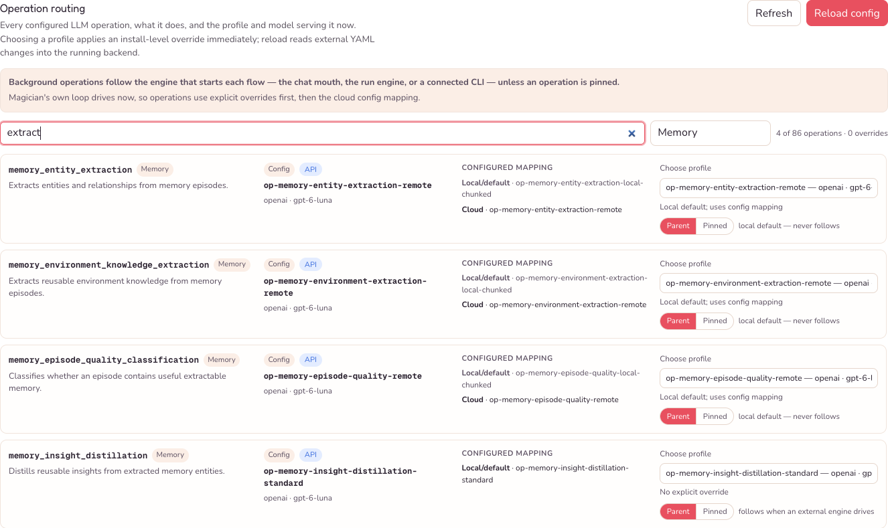
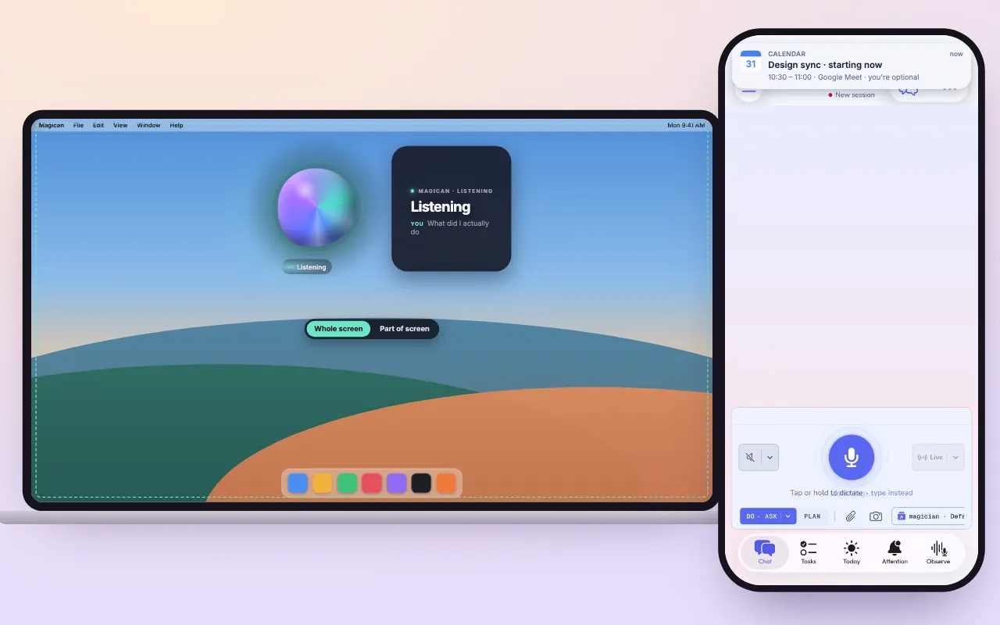
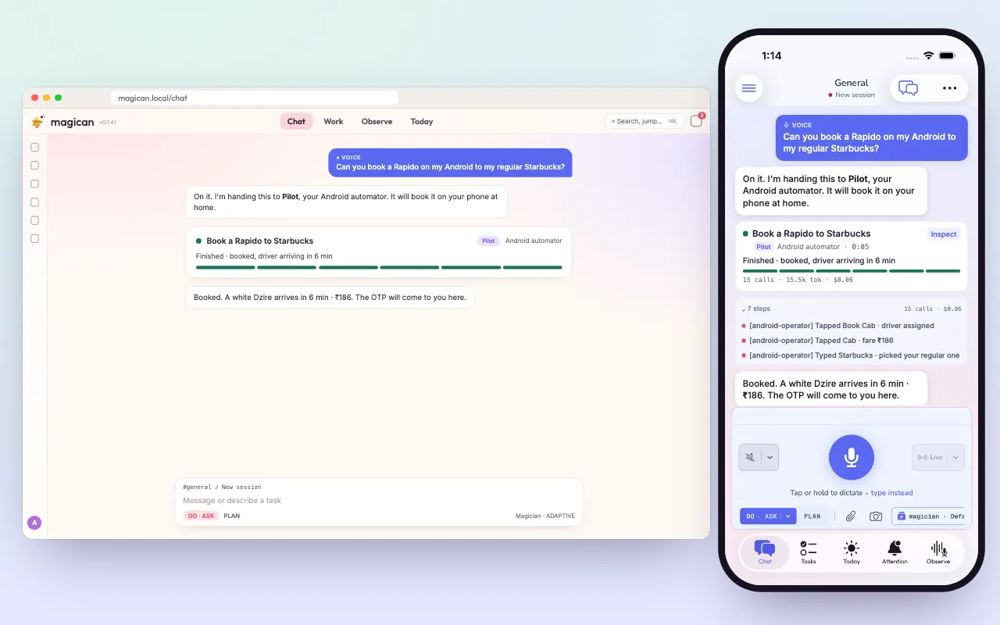
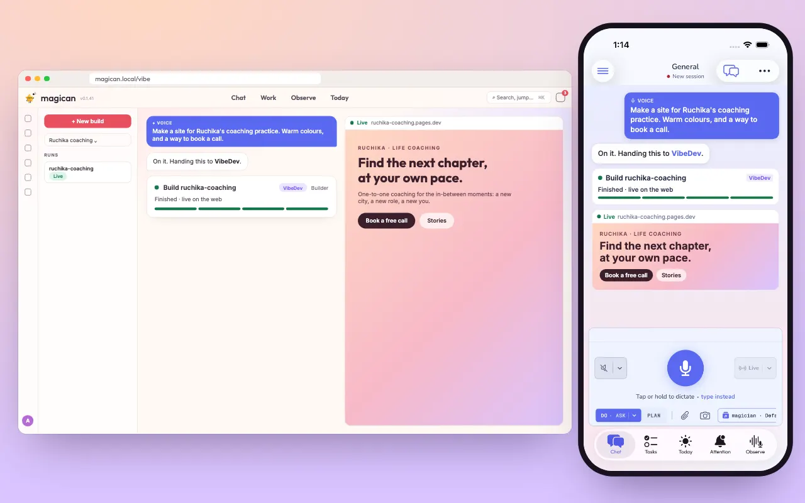
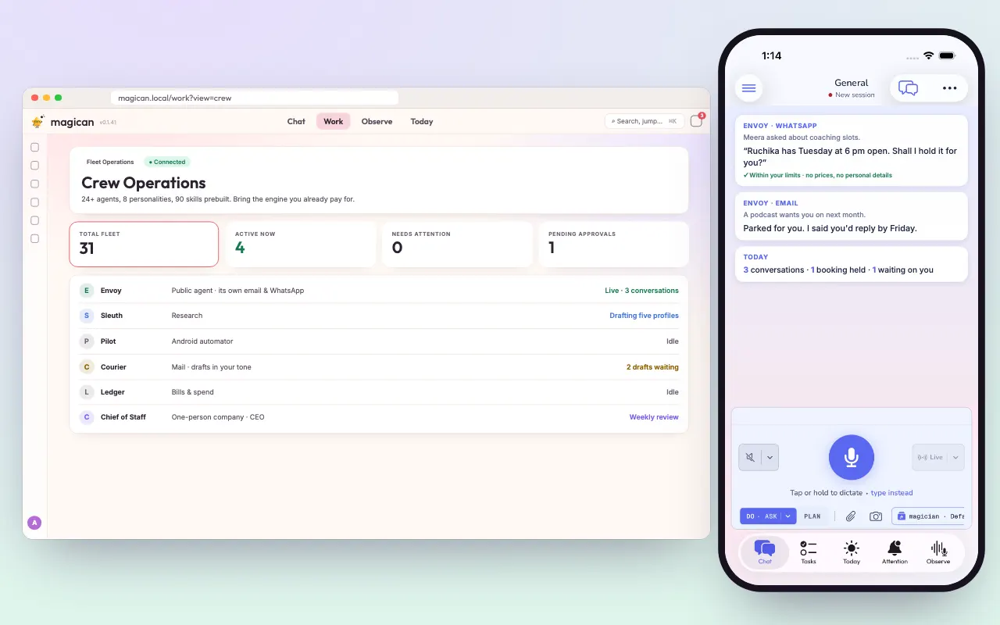
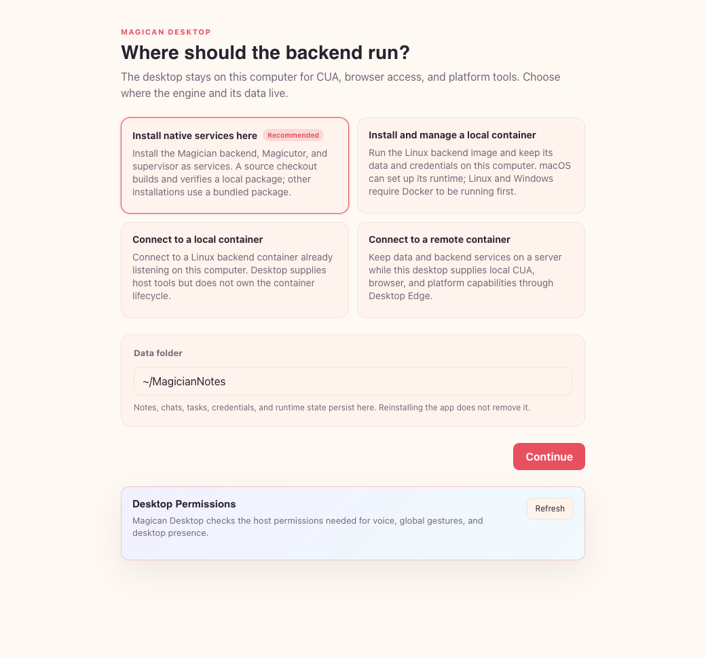
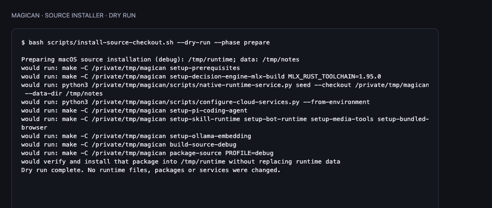
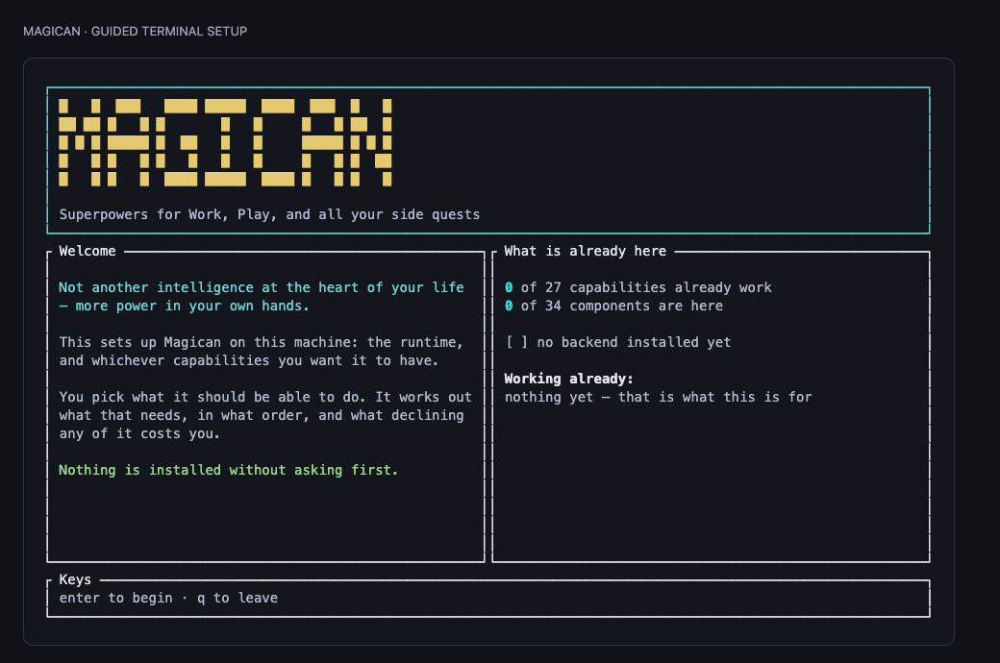

<div align="center">

  <p>
    <picture>
      <source media="(prefers-color-scheme: dark)" srcset="docs/assets/brand/mascot-hi-dark.svg">
      
    </picture>
    <br/>
    <picture>
      <source media="(prefers-color-scheme: dark)" srcset="docs/assets/wordmark-dark.svg">
      
    </picture>
  </p>
  <h2>
    Open-source Operating system for building Personal AI<br/>
    <sub>Foundations for Personal Superintelligence</sub>
  </h2>
  <p>
    <b>Powering <a href="https://next.magican.ai">Magican</a> — Your personal superpowers.</b>
  </p>
  <p>
    <a href="magician/Cargo.toml"></a>
    <a href="#license"></a>
    <a href="#architecture"></a>
    <a href="#everything-it-does"></a>
    <a href="https://discord.gg/USDChWhdj"></a>
  </p>
  <p>
    <a href="https://explain.magican.ai"><b>Break it open in 3D →</b></a>
    &nbsp;&middot;&nbsp;
    <a href="https://next.magican.ai/#film"><b>Watch the film</b></a>
    &nbsp;&middot;&nbsp;
    <a href="#quick-start"><b>Install</b></a>
    &nbsp;&middot;&nbsp;
    <a href="https://discord.gg/USDChWhdj"><b>Discord</b></a>
  </p>
</div>

**Personal intelligence, under your control.** Build an assistant that remembers,
works across your apps and carries ongoing work forward. Its identity, memory
and history stay with you as you change models.

## Why it's different — You choose how your AI works

Magician is open source. You can inspect the code, change the configuration and
run it on your own machine or server. Choose which model handles your messages,
where memory is processed, how agents reason, and what they are allowed to do.

| What matters | What you control |
| --- | --- |
| **Which model reads your messages** | Choose models for chat responses and channel processing separately. |
| **Where memory is processed** | Route memory extraction, summaries and review to local or hosted models. |
| **How your assistant reasons** | Choose the chat and Work harnesses and their models. |
| **What it can do for you** | Set agents' tool permissions, approval rules and budgets. |
| **Where it runs and keeps your notes** | Use your own machine or server and choose your notes folder. |

**Settings → Model routing** shows each configured operation, its purpose,
provider, model and current route. Choose a local model for memory work and a
different provider for chat, or pin an operation to its own model while changing
the main engine. Settings also exposes trust rules, local models and notes;
agent definitions and runtime configuration provide the deeper controls.

<p align="center">
  
  <br/>
  <sub>Actual Model routing settings: see and change the model serving each operation.</sub>
</p>

[Model-routing controls](docs/components/unified-ui/model-routing-panel.md) ·
[Models and harnesses](#models-and-harnesses) ·
[Agent definitions](magician_data_v3/system/agent_templates/README.md)

<p align="center">
  <b>31</b> agents &nbsp;·&nbsp; <b>90+</b> skills &nbsp;·&nbsp; <b>10</b> model backends
  &nbsp;·&nbsp; <b>5</b> swappable reasoning engines &nbsp;·&nbsp; <b>6</b> chat channels
  &nbsp;·&nbsp; <b>86</b> features you can open up in 3D
</p>

> [!WARNING]
> **Pre-release.** Magician has not reached v1.0. APIs, configuration, data
> formats and surfaces may change before then. Pin versions for integrations
> and expect migrations.

## Things it does that you might not expect

**Demos coming soon.**

### Help me find and land a role worth taking

> Use my CV, past projects and priorities to understand what I'm looking for.
> Find roles worth pursuing, research the teams, tailor my applications and
> prepare me for interviews. Track the responses and refine the search as we
> learn more.

Define what **worth taking** means to you: the work, pay, location, team and
room to grow. The goal can carry through research, applications and interview
preparation across sessions, with sources, drafts and decisions kept together.

Relentless independently reviews the recommendations against your criteria and
checks that tailored applications stay true to your experience. Drafts that miss
the bar get another pass within your budget. You set the approval rules and
steer the search as your priorities change.

[Work and Quality](docs/components/magician/relentless.md)

<table>
  <tr>
    <td width="50%" valign="top">
      
      <b>Send your assistant to a meeting.</b> It can join Google Meet and
      WhatsApp calls, listen or participate, and speak when addressed. Meeting
      context carries into its memory, with follow-ups surfaced afterwards.
      <a href="docs/components/magician/meetings.md">Meetings</a>
    </td>
    <td width="50%" valign="top">
      
      <b>Your phone's at home. Your ride's booked on it.</b> It works the apps
      you already use: your signed-in browser, your Mac, even an enrolled
      Android you left at home. <a href="docs/components/magician/device-bridge.md">Device bridge</a>
    </td>
  </tr>
  <tr>
    <td width="50%" valign="top">
      
      <b>Build an app with a coding crew.</b> VibeDev gives agents separate
      branches and brings their work back into one pull request. Follow the
      terminals, diffs and previews, and steer a run from your phone.
      <a href="docs/components/magician/vibedev-rail.md#82-crews">VibeDev</a>
    </td>
    <td width="50%" valign="top">
      
      <b>A public agent, with its own email and WhatsApp.</b> A sandboxed envoy
      answers strangers on its own channels, inside the limits you set, while
      your private assistant stays private.
      <a href="docs/components/magician/envoy-agent.md">Envoy</a>
    </td>
  </tr>
</table>

- **Run a coding crew.** Give VibeDev one goal and it splits it into up to
  eight lanes, each a coding run on its own branch, then merges them into one
  branch and one pull request. Race mode gives every lane the whole goal and
  lets you keep the best attempt. Watch runs from the Mac's notch or your
  phone's lock screen, and steer one by name: *"tell the API lane to use
  Postgres."* [Crews](docs/components/magician/vibedev-rail.md#82-crews)
- **It checks before it speaks for you.** Every outward send or booking is
  checked against your stated preferences and gated in one Attention inbox you
  can answer from any device.
  [Preference alignment](docs/components/magician/preference-alignment.md) ·
  [Approvals](docs/components/magician/hitl-attention.md)
- **The model never sees your keys.** MagicVault keeps credentials encrypted per
  workspace and injects them into tool calls, so codes, passwords and cards
  never enter a prompt. [Feature map](docs/features/README.md)
- **Tap Option anywhere.** Rewrite, reply, summarise or turn into a task
  whatever you're looking at, in any app. [Contextual assist](docs/features/contextual.md)
- **Budgets in consequences, not just dollars.** An agent can be allowed ten
  emails, three WhatsApp messages and one `git push` today, enforced by a
  double-entry ledger. [Resource authority](docs/components/magician/resource-authority-api.md)
- **Swap the model, keep the assistant.** Route one agent from a frontier API to
  a local Ollama model and it keeps its name, memory, history and obligations.
  [Models and harnesses](#models-and-harnesses)

## Break it open

**[explain.magican.ai](https://explain.magican.ai)** is the whole system as an
interactive 3D model you can take apart.

- **Discover what it does.** Browse 86 features, filter by name or maturity,
  and light up the parts of the system behind each one.
- **Follow the story.** Narrated tours follow a request from chat, a task,
  your voice or an app into the code that handles it: which engine reasons,
  which model is called, how tools run.
- **Go deeper in Nerd mode.** Open processes, crates, modules, files and types,
  each with its source reference, version and last commit.

It is rebuilt from the code itself, so it doesn't drift. The source and a local
walkthrough are in [`showcase/anatomy/`](showcase/anatomy/README.md).

## OS primitives for Personal AI

Models supply cognition. Harnesses supply reasoning loops. **Magician supplies
the persistent, governed world those loops operate within**, where every
action and tool use is both an output and the next input. It is the scheduler,
isolation, permissions, accounting, drivers, package manager and app platform
an assistant needs, on your machine or in the cloud.

| # | OS primitive | In Magician | Current status |
| :--- | :--- | :--- | :--- |
| 1 | **CPU** | Local and hosted models, routed per operation. | Ships. |
| 2 | **Process** | Persistent agents with identity, memory, permissions and work history, declared in YAML. | Ships. |
| 3 | **Scheduler** | Scheduled tasks, triggers, recurring monitors and autonomous cycles. | Ships. |
| 4 | **Process isolation** | `magic-supervisor`, per-channel daemons, out-of-process `magicutor` and governed process jails. | Ships. |
| 5 | **Memory management** | Typed tiers, consolidation and retention over Parquet + LanceDB. | Ships. |
| 6 | **Filesystem** | Scoped storage and a shared storage abstraction. | Local storage ships; cloud storage remains in flight. |
| 7 | **Permissions** | Trust levels, tool and parameter policies, and scoped tokens and grants. | Policies ship; the capability resolver remains `LocalPermissive`. |
| 8 | **Accounting** | A double-entry ledger, reservations and reserve→commit for declared costs, including `EMAIL_SENDS`, `WHATSAPP_SENDS` and `GITHUB_PUSHES`. | Ledger built; declared-cost coverage across tools remains incomplete. |
| 9 | **Device drivers** | Channel adapters for AgentMail, Gmail, Kapso, Telegram, Telegram-self and WhatsApp. | Ships. |
| 10 | **Package manager** | Skillshub validation, installation and workspace-scoped discovery. | Ships. |
| 11 | **App Platform** | Typed app contracts, a kernel, authoring tools, a TypeScript SDK, entity storage and custom surfaces. | Contract and kernel present; the installable catalogue remains in flight. |

The [OS primitives reference](docs/architecture/os-primitives.md) explains the
mapping and its current limits.

> **The agent is what survives a model swap.** Its identity, memory, obligations
> and ledger belong to the runtime, not the model.
>
> We rent cognition. We own identity and continuity. Personal intelligence is
> your asset, and Magician is built to keep it yours.

---

<a id="quick-start"></a>

## 🚀 Quick start

Magician runs on macOS 14 or newer on Apple Silicon. Linux runs the stack
through the container flow today; a native Linux path is coming.

```bash
git clone https://github.com/MagicBeansAI/MagicianAI.git
cd MagicianAI
make install          # or: make setup-wizard, to choose capabilities first
```

`make install` asks where your data lives (default `~/MagicianNotes`), installs
what Magician needs, builds it, starts Magican Desktop and the runtime, and
waits until they are ready. Your existing configuration, credentials and notes
are kept. Then open Magican Desktop, or `http://localhost:3002`; the runtime
starts again at login.

### Choose your installer

| Desktop GUI | Shell | Guided terminal (TUI) |
| --- | --- | --- |
| [](docs/assets/screenshots/installer-gui.png) | [](docs/assets/screenshots/installer-shell.png) | [](docs/assets/screenshots/installer-tui.png) |
| Review placement and your data folder. | `make install` | `make setup-wizard` |

Click a screenshot to enlarge it. These are safe setup previews: the GUI uses
placeholder configuration, and the shell and TUI run without installing anything.

> [!NOTE]
> **Installers are new.** The guided terminal and Desktop installers build from
> a source checkout on macOS; full installation validation is still in
> progress. The macOS app is going through Apple's notarisation and the iOS and
> Android apps are in store review. Until they land, the phone apps are built
> from source; see [`docs/setup/mobile.md`](docs/setup/mobile.md).

### Cloudflare setup (optional)

Local use needs no Cloudflare account. For remote devices, browser access or
provider webhooks, use a domain you control with **Cloudflare Tunnel** and
**Cloudflare Access**. Each computer gets its own tunnel and hostnames.
Select **Reach this computer remotely** in terminal or Desktop setup, or run
`make setup-cloudflare` from the checkout.

1. Add your domain to Cloudflare and configure a Zero Trust organization.
2. Enter your zone, account ID, scoped token, machine label and browser email
   allowlist in setup; they are saved in your private runtime environment.
3. Approve the per-machine tunnel step on the computer you want to expose.

The [Cloudflare setup guide](docs/setup/cloudflare.md) lists the exact permissions,
environment keys and verification steps. Device and UI hosts use Access;
provider webhook hosts stay reachable with provider authentication. Tunnel,
Access and Pages credentials stay outside the repository. Cloudflare Pages
publishing from VibeDev is configured separately and is optional too.

**Clarity session recording is optional and off by default.** Terminal and
Desktop setup offer an explicit opt-in using your own tracking project; the
shell equivalent is `make setup-clarity`. See [Clarity setup and disabling](docs/setup/clarity.md).
Website recording has its own setup choice and `make setup-clarity-website`;
it never opts the personal app in.

<details>
<summary><strong>More ways to install, and developing on Magician</strong></summary>

#### Guided terminal installer

Choose what you want Magican to do (remember, code, browse, or connect to your
channels). The wizard checks what already works, shows what your choices need,
and lets you review the plan before anything is installed.

```bash
make setup-wizard                  # choose, review, install and verify
make setup-wizard ARGS=--dry-run   # rehearse with real checks; changes nothing
make setup-wizard ARGS=--status    # what is installed and what it enables
```

See the [terminal installer guide](docs/components/magician-setup/README.md).

#### Magican Desktop

In Magican Desktop, choose **Install native services here** during setup.
With a source checkout available, review the plan, approve it, and follow
progress in the window. Once the runtime is ready, sign in and choose your
capabilities, model preferences and accounts. See the
[Desktop setup guide](docs/components/desktop/README.md#guided-first-run-setup).

#### Non-interactive (CI)

```bash
MAGICIAN_INSTALL_MODE=dev MAGICIAN_INSTALL_FLOW=local \
  MAGICIAN_ROOT_DIR="$HOME/MagicianNotes" MAGICIAN_INSTALL_YES=1 \
  bash scripts/install.sh
```

The MODE × FLOW × RUNTIME matrix, container runtimes, browser modes and
environment variables are in the [full quick start](docs/quickstart.md).

#### Developing on Magician

Stop the installed backend, then use the foreground development flow:

```bash
launchctl bootout "gui/$(id -u)/ai.magicbeans.magican.backend"
make setup-all        # developer dependencies, scope setup, optional toolchains
make build-all-debug
make run-all          # UI, supervisor, desktop, codegraph and tunnel setup
make run-ui-dev       # Vite at http://localhost:5173, for UI work
```

Tell it who it is, then give it channels:

```bash
make setup-identity   # owner name, agent inbox, Cloudflare zone — never defaulted
make setup-bots       # WhatsApp, Telegram, Gmail and AgentMail channel daemons
```

Optional: [keys and paid services](docs/setup/api-keys.md),
[channels](docs/setup/channels.md),
[Google Workspace](docs/setup/google-workspace.md) and
[mobile apps](docs/setup/mobile.md).

</details>

---

<a id="everything-it-does"></a>

## ⚡ Everything it does

The runtime is the centre of a larger system: 31 agent templates, 90+
AgentSkills packages, 7 bot packages, and first-party web, desktop, mobile and
embedded clients. The [ecosystem map](docs/ecosystem/README.md) owns the full
boundaries and status; the [feature map](docs/features/README.md) is the
operator-facing inventory.

| Area | What you get | Read more |
| :--- | :--- | :--- |
| **Agents as data** | Persona, tools, delegation policy, memory tiers and prompt pipeline in one YAML file per agent. 31 ship. | [agent templates](magician_data_v3/system/agent_templates/README.md) |
| **Autonomous agents** | Agents run on their own schedule with prioritised focus areas and a markdown charter. An autonomous cycle is its own code path, not a fake user turn. | [autonomous agents](docs/components/magician/autonomous-agents.md) |
| **Memory** | Per-agent typed tiers (schema, scope, retention, consolidation) declared in YAML over Parquet + LanceDB. Owner memory keeps revision history, reconciles duplicates and asks about uncertain conflicts. | [memory tiers](magician_data_v3/system/agent_templates/README.md#pluggable-memory-tiers-per-agent-schema) <br> [memory index](docs/components/magician/memory-index.md) <br> [memory lifecycle](docs/components/magician/memory-lifecycle.md) |
| **Today and Attention** | One daily page: For you, Worth a look, Follow-ups, Active work. Background reasoning connects relevant memories with an item, and every question or approval lands in one inbox. | [attention lanes](docs/components/unified-ui/today-attention-lanes.md) <br> [resurfacing](docs/components/magician/resurfacing.md) <br> [memory connections](docs/components/magician/memory-connections.md) |
| **Recurring monitors** | Standing watches on pages, sites and searches that report only when something material changes. | [monitors](docs/components/magician/recurring-monitors.md) |
| **Relentless** | Bounded improvement of a draft or media artifact until independent critics accept it, with exact-artifact review. | [relentless](docs/components/magician/relentless.md) |
| **VibeDev** | A project-aware coding studio and `@vibedev` chat/voice rail with pluggable coding engines, live terminals, diff review, previews, checks, checkpoints and deploys. Crews run parallel lanes into one branch and pull request; live runs show in the notch and on iPhone and Android. | [VibeDev rail](docs/components/magician/vibedev-rail.md) <br> [developer workbench](docs/components/magician/developer-mode-workbench.md) |
| **Channels** | WhatsApp, Telegram, Gmail and AgentMail, each a supervised per-platform daemon over a six-method adapter. A sandboxed envoy answers the public. | [bot SDK](skillshub/bots/sdk/README.md) <br> [design](docs/consumer_channels.md) <br> [envoy](docs/components/magician/envoy-agent.md) |
| **Approvals and alignment** | Every outward send is gated, checked against your preferences, and answerable from any device. | [HITL](docs/components/magician/hitl-attention.md) <br> [preference alignment](docs/components/magician/preference-alignment.md) |
| **Budgeted spend** | Declared costs reserve against a double-entry ledger that has to balance: ceilings, reservations, two-phase commit, and commodities beyond money (`EMAIL_SENDS`, `GITHUB_PUSHES`). | [resource authority](docs/components/magician/resource-authority-api.md) |
| **Voice and realtime** | One set of wake-word, dictation and realtime audio rails shared by desktop, iOS and Android. The wake phrase summons the Orb and starts a Dictation, Hands-free or Live rail. | [media rails](docs/components/magician/realtime-media-rails.md) <br> [wake word](docs/components/unified-ui/wake-word-voice.md) |
| **Meetings** | An agent that joins, hears the room through a native Core Audio bridge, and can speak back into it. Prep brief before, tracked follow-ups after. | [meetings](docs/components/magician/meetings.md) |
| **Screen and contextual assist** | Ask what is on screen, start a sustained watch ("tell me when the build finishes"), or tap Option to act on whatever you're looking at. | [screen](docs/components/magician/screen-capture-and-ask.md) <br> [contextual](docs/features/contextual.md) |
| **Browser automation** | Drives your signed-in Chrome through an extension, out of process in `magicutor`; headed and headless fallbacks, per-thread owned tabs and live preview. | [magicutor](docs/components/magicutor/README.md) |
| **API mining** | Task Recipes compile answer-bearing browser traffic into reusable API steps, so repeated browser tasks can run as direct calls. Unsafe or unsupported cases fail closed or use a guarded fallback. Live acceptance remains pending. | [pipeline](docs/components/magician/api-mining-pipeline.md) |
| **Learning loop** | Successful runs become evidence-backed procedures; repeated success can create review- and eval-gated skill proposals. Shipped skills are never silently rewritten. | [learning procedures](docs/components/magician/learning-procedures.md) <br> [outcome learning](docs/components/magician/outcome-learning.md) |
| **Skills** | 90+ AgentSkills packages, one `SKILL.md` contract each. Discovery is scope-aware, supports registry roots and whole-folder overrides, and filters through each agent's allowlist. | [skillshub](skillshub/README.md) <br> [spec and discovery](docs/components/magician/skills-spec.md) |
| **Generative UI** | Agents emit layout documents; 71 components render charts, metric cards, feeds and forms, not a transcript. | [unified UI](docs/components/unified-ui/README.md) |
| **Notes, Tutor and mail** | Markdown notes the agent reads and writes with you on every device; blackboard-style teaching; Gmail triage. | [notes](docs/components/magician/notes-provider.md) <br> [tutor](docs/components/magician/personal-tutor.md) <br> [mail assist](docs/components/magician/mail-assist.md) |
| **App Platform** | Typed contracts and a runtime kernel, authoring CLI, TypeScript SDK, entity storage, memory contributions, custom surfaces and governed action dispatch. The installable catalogue remains in flight. | [truth baseline](docs/components/magician/app-platform-truth-baseline.md) <br> [apps](docs/components/magician-apps/README.md) <br> [SDK](docs/components/magician/typescript-apps-sdk.md) |
| **Event lakehouse** | Every event partitioned by principal and workspace; runs replay from canonical Parquet/JSONL. | [storage model](docs/ARCHITECTURE_V2.md#current-v3-storage-model) <br> [storage abstraction](docs/components/magician/storage-abstraction.md) |
| **MCP** | A governed client over the official Rust MCP SDK, plus an authenticated Plane server for external harnesses. | [mcp client](docs/components/magician-mcp-client/README.md) <br> [plane server](docs/components/magician/plane.md) |
| **Code intelligence** | The indexed workspace as a C4 canvas, 2D/3D graph and searchable impact/flow model, exposed to coding agents over MCP. | [Code Graph Explorer and MCP](docs/codegraph/README.md) |
| **Surfaces** | macOS tray and notch Orb, iOS (Magios), Android (Magdroid), an ESP32 voice terminal and a Kindle thin client. | [desktop](docs/components/desktop/README.md) <br> [iOS](docs/components/magios/README.md) <br> [Android](magdroid/README.md) <br> [ESP32](docs/components/magesp/README.md) <br> [Kindle](kindle/README.md) |

---

<a id="models-and-harnesses"></a>

## 🔌 Bring your own model, and your own reasoning loop

Magician keeps three things apart: the **agent** (identity, memory,
permissions, history and budget), the **model** that supplies cognition, and the
**harness** that runs the reasoning loop. Change the last two without replacing
the agent or giving up its authority boundary.

- **Models.** Ten native backends: OpenAI, Anthropic, Google Gemini, MiniMax,
  DeepSeek, OpenRouter, xAI, Sarvam, Yutori N1\* and local Ollama. Planning,
  extraction, summarisation and memory work can each use a different one in
  **Settings → Model routing**. You decide what stays private, where you need
  more capability, and how speed and cost shape the work.
- **Your subscription.** A signed-in Claude Code, Codex, Grok or Antigravity
  (`agy`) CLI can serve selected operations as a text-only model: no tools, no
  MCP, no agent authority.
- **Harnesses.** Swap Magician's own loop for `claude_code`, `codex`,
  `codex_app_server`, `grok` or `agy` for chat, for agentic runs, or both.
  Magician still owns persistence, approvals, tool dispatch and budgets.
- **The harness you already use.** Mint a terminal grant and point any
  MCP-capable harness at Magician's Plane MCP server. It can call only granted
  tools, under the grant's agent, expiry and spending ceilings, and approvals
  come back into the same session.

| Change point | Selector |
| :--- | :--- |
| **Chat** | **Settings → Terminal grants → Chat mouth**, or `chat.harness_engine` |
| **Agentic and scheduled runs** | **Run engine** in the same panel, or `execution.harness_engine` |
| **Background model calls** | **Settings → Model routing**, or `llm.router.operation_mapping` |
| **An external harness** | A `plt_` grant plus `/api/magician/v2/plane/mcp` |

Details: [plane contract](docs/components/magician/plane.md),
[chat engine boundary](docs/components/magician/chat-mode.md) and
[model-routing controls](docs/components/magician/llm-routing-overrides.md).

---

## 🤖 Agents and skills

### Agents as data

> **Agent** *(noun)*: a persistent named entity with memory, obligations, and a history.

Not a prompt with tools, and not a loop that calls them; those are features of
whatever model you point at this. Agents here are defined purely in data: a
shipped one runs 500 to 760 lines of declaration covering persona, wake
spellings, invocation policy, allowed and denied tools, denied tool
*parameters*, trust level, typed memory tiers, consolidation rules, circuit
breaker, notification rules, retention and delegation targets.

This is the head of a shipped one ([`web-researcher`](magician_data_v3/system/agent_templates/agents/web-researcher/definition.agent.yaml)):

```yaml
agent_id: web-researcher
version: 3
name: Sleuth
aliases:
- sleuth
- researcher
- wr
description: "Web research and synthesis: searches diverse sources—news, technical docs, community forums, academic—to find, cross-reference, and synthesize cited answers to complex queries."
persona: |
  You are Sleuth, an accurate, economical web researcher. Find current public
  evidence, read only what is needed, and return a concise answer whose factual
  claims can be checked from its citations.
# … tools, delegation policy, memory tiers, prompt pipeline, constraints
```

Copy the folder, change the YAML, and the runtime picks it up. The schema and
memory-tier declarations are in the
[agent templates README](magician_data_v3/system/agent_templates/README.md).

`llm_routing` is nullable, and thirty of the thirty-one shipped agents name no
model at all. Route one from a frontier API to a local Ollama model and it is
the same agent: same memory, same obligations, same ledger, and it still
answers to its name. Replace its memory tiers and it is a different agent on the
same model.

### Drop-in skills

Skills are folders with a `SKILL.md`. Validate one, then install the bundle into a workspace:

```bash
python3 skillshub/scripts/validate_skill_md.py /path/to/your/skill/
scripts/magician-skills install --scope anonymous/default
```

*The five-minute walkthrough for a third-party skill is [`skills-quickstart.md`](docs/components/magician/skills-quickstart.md).*

---

<a id="architecture"></a>

## 🏗️ Architecture

Don't trust a frozen diagram; regenerate it. `make graph-index` rebuilds the
workspace graph from the current tree, `make graph-check` detects stale graph
and architecture references, and `make graph-serve` opens the C4 canvas and the
2D, 3D and node explorers under [`docs/codegraph/`](docs/codegraph/). Point a
coding agent's MCP client at [`docs/codegraph/mcp_server.py`](docs/codegraph/mcp_server.py)
for structural search, architecture explanations, endpoints, flows and audits.
The narrative (components, the V3 storage model, runtime flow, ports) is in
[`docs/ARCHITECTURE_V2.md`](docs/ARCHITECTURE_V2.md).

**The workspace in one breath:**

* `magician`: core orchestration, authority, execution and storage seams.
* `magician-api`: HTTP and WebSocket route owners (`/api/magician/v2`).
* `magician-bin`: process composition, boot order and workers.
* `magician-comms`, `magician-media`, `magician-learning`, `magician-surfaces`, `magician-chunking`, `magician-apps`: channel ingestion, realtime media, outcome learning, thinking maps, chunking and apps.
* `magicutor`: the out-of-process browser and tool executor.
* `magic-supervisor`: process supervision and restart policy.
* `magicllm`: model providers and routing.
* `magician-mcp-client`, `tool-runtime-core`, `runtime-core`: the MCP boundary, local capability registry and shared traits.
* `ui/unified-ui` is the web UI and `desktop/` the Tauri tray; `magios/`, `magdroid/`, `magesp/` and `kindle/` are the device clients.

---

## 📚 Documentation

* [**Docs hub**](docs/README.md): the entry point.
* [**Showcase Explorer**](https://explain.magican.ai): the system in 3D, narrated feature tours and Nerd mode ([source](showcase/anatomy/README.md)).
* [**Ecosystem map**](docs/ecosystem/README.md) and [**feature map**](docs/features/README.md): what exists, its boundaries and status.
* [**Architecture**](docs/ARCHITECTURE_V2.md) and [**Code Graph Explorer**](docs/codegraph/README.md).
* [**Quick start**](docs/quickstart.md): installers, install matrix, runtime root, config and tunnels.
* [**Testing**](docs/testing.md) and [**Deployment**](docs/DEPLOYMENT.md).
* [**Component index**](docs/components/README.md): one doc per crate and surface.
* [**Project versions**](docs/project-versions.md) and [**dependencies**](docs/dependencies.md).
* [**Contributing**](CONTRIBUTING.md): conventions, checks and hooks.

---

## 🗺️ Where this is going

Magician is step one toward zero-trust, sovereign, personal AI.

* **Harness hardening:** replaceable chat and run engines are live. Next: make
  chat-harness continuation durable across process restarts, and append
  resume-executed approved actions to the run's iteration record.
* **App layer:** the app contract is built; the installable catalogue on top of
  it isn't yet.
* **Stores and Linux:** the signed macOS app and the iOS and Android store
  builds, then a first-class native Linux install.

---

## 🤝 Contributing

Questions, or want to see what people are building with it? [Join the Discord](https://discord.gg/USDChWhdj).

Read [`CONTRIBUTING.md`](CONTRIBUTING.md) first: `make check-all` for compilation, `make setup-hooks` once per clone for the docs-freshness gate, and `make fmt` before you push. CI checks formatting.

<details>
<summary><strong>AI assistant setup</strong></summary>

The repo ships ready-made configs for coding agents. `AGENTS.md` is the canonical project-rules file (Codex, Grok, ZCode, Antigravity/`agy`). Claude Code imports it from `CLAUDE.md`. Gemini CLI loads it via `.gemini/settings.json` `context.fileName`. Docs-freshness hooks live in `.claude/settings.json`, `.grok/hooks/`, `.gemini/settings.json`, `.agents/hooks.json` (`agy`), and `.zcode/config.json`. Codegraph MCP is wired in `.mcp.json`, `.codex/config.toml`, `.gemini/settings.json`, `.agents/mcp_config.json`, and `.zcode/config.json`. Claude slash commands are `.claude/commands/` (`/sync-api-docs`, `/sync-websocket-events`, `/sync-all-docs`). See [`docs/process/ai-doc-hooks.md`](docs/process/ai-doc-hooks.md).
</details>

Unless you explicitly state otherwise, any contribution intentionally submitted for inclusion in the work by you, as defined in the Apache-2.0 license, shall be dual licensed as below, without any additional terms or conditions.

---

<a id="license"></a>

## 📄 License

Licensed under either of:

* Apache License, Version 2.0 ([LICENSE-APACHE](LICENSE-APACHE) or http://www.apache.org/licenses/LICENSE-2.0)
* MIT license ([LICENSE-MIT](LICENSE-MIT) or http://opensource.org/licenses/MIT)

at your option.

Third-party components keep their own licenses: `magdroid/` is derived from NeuralBridge and stays under Apache-2.0 with its [NOTICE](magdroid/NOTICE); bundled font notices cover [iOS](magios/Magios/Fonts/NOTICE.txt), [Android](magdroid/android/app/src/main/assets/font_licenses_notice.txt), and [Tauri](desktop/public/fonts/NOTICE.txt), while Web font licenses remain under `ui/unified-ui/static/fonts/`. The 3D assets under `ui/unified-ui/static/fleet/` and display components under `magesp/components/` carry their own license files alongside.

\* **Yutori N1:** currently broken in the latest builds.
