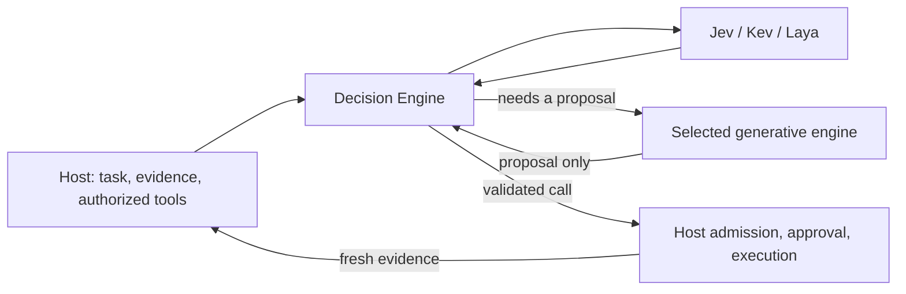

# Structured decision plane — living contract

Agentic execution and managed direct chat use the tool-independent `/v1/action`
rail when `tool_action_judge` is configured (the repo seed enables it with hosted
Jev). All authorized tools (Browser, Android, CUA, …) share one catalog, planner
escalation and action lowering; there is no surface-specific judge code, config
or pack. `/v1/step` has no handler. Contract version 5 (`CONTRACT_VERSION`)
carries native/harness action proposals, bounded classification batches, and
memory authorization plus observation/batching policy in engine discovery.
Upgrade host and engine together; mixed major versions fail closed.

Native planner adapters heap-allocate provider dispatch futures so nested debug
calls fit worker stacks. Catalog argument projection follows the dispatch
policy's passthrough classification: ordinary browser arguments stay available,
explicit outward actions keep their gates.

Design history: structured decision plan,
shared action rail record.

## What this is

A vendor-neutral plane for **typed decisions**: Choice (pick from declared
options, with the full distribution), Score (rubric level) and Noul (yes/no
probability), asked as versioned question packs against a state and answered by
swappable adapters. One HTTP adapter serves every `/v1/systemone` model: hosted
TypeSafe Jev (`typesafe`) and self-hosted Jev-style models such as laya or Kev
(`systemone`). Planned: a `generative` fallback (same IR via a chat model,
uncalibrated). Code owns policy (funnels, required-action rules, grants, loop
detection), LLMs own prose, and this plane owns the judgments in between whose
output code consumes.

## Default model dispatch

Every engine-managed Jev, Kev and Laya call enters a bounded in-memory per-model
queue on `runtime_core::fair_queue::FairLane` (the MagicLLM component; separate
queues per process; decision jobs never become LLM requests). Owners run FIFO
within a lane and operations take turns; background gets a turn after three
foreground pickups and reserves one foreground slot when concurrency permits.
Routing, thresholds, fallback and provider retry stay in the engine; native and
harness LLM calls outside the managed router are out of scope.

- `queue_capacity` (default 64) and `queue_max_bytes` (default 4 MiB) bound
  waiting work separately from `max_in_flight`; admission is capped at 120 s
  even without a caller deadline.
- Cancelling a waiter releases its reservations; queue pressure or expiry never
  marks a provider unhealthy or creates a receipt. Compatible reloads resize the queue;
  queue settings never enable local fallback.
- Local seeds allow one active request; MLX handoff skips cancelled work, but a
  running GPU kernel keeps its slot until done.
- Background gates may set `classification.queue_budget_ms` plus
  `decision_budget_ms`; inference time starts after admission and the caller
  deadline (including reserved text time) wins. Memory background seeds: 30 s
  queue + 30 s inference, one item at a time; foreground `memory_applicability`
  keeps 3 s.
- Receipts report `queue_wait_ms` apart from `latency_ms` (repeated, not summed,
  across retries); cost stays one record per physical attempt.

Tests: `make test-model-dispatch`.

## Shared action rail

The engine owns candidates, routing and fit, thresholds, consecutive-step
limits, planner escalation and selection. Magician supplies the authorized
catalog, task instructions, safe tool-result projections and observations;
returned calls go through ordinary native lowering and Apply authorization,
approval and verification. Cancellation, resource limits, loop protection and
privacy stay host obligations.



### Selection and fallback

`decision-engine-contract::action` is the contract; `magician-decision/src/action`
implements it with no tool-name branches (skills need no annotations). A
request carries authorized tool schemas, bounded evidence, task context and an
optional continuation plan.

- **Candidates** come from the next proposed step or from schema constants,
  enums, booleans and matching typed values in successful evidence, and must
  pass the tool's JSON Schema (external refs refused; `validate_call`). A host
  marker (`{"$ref": "<string>"}` alone, or `{"$file": "<string>"}` with optional
  `format`) stands in for any value: errors at or inside it are ignored because
  the host substitutes and checks the full value before dispatch. Free-form
  text, opaque JSON strings and ungrounded values need a generative proposal.
  A rejection names the planned tool and what the next proposal should change.
- **Two typed stages**: a selector picks a concrete call or asks for a planner;
  a review judges **that exact call** for evidence sufficiency and
  applicability; both must meet the answering model's thresholds. Missing
  routes, unfit models, uncertainty, a failed previous action, changed
  instructions, an exact repeat or the consecutive-step cap escalate.
  `action_timeout_ms` bounds both (default 8,000 ms; 0 skips typed evaluation);
  the host socket timeout must exceed it. An oversized request for a pinned
  model escalates; evidence is never truncated.
- **Plans stick** (agent runs and chat). While steps remain, the host sends the
  stored continuation to `ResolvePlanner`, which validates it against the
  current catalog and schema and fills bindings from evidence; no model is asked
  and Jev's Select never sees it. A failed step, an operator or recovery steer
  (agent runs), a rejected step or `task_instructions_changed` (against the
  continuation's stamped scope) drops it. Otherwise Jev selects; when it
  cannot, the run's engine proposes the complete sequence to the goal (bindings
  for steps needing an earlier result), which then sticks. Logs record `decided_by = plan | jev | engine_planner` and Jev's escalation reason.
- **Escalation on Magician's engine** (agent runs; chat-native alike): no
  planner turn. The rail returns a `ProposalCheck`; the model decides with its
  real tools and every work call (each `Pack` action, folded batches included)
  goes to `ResolvePlanner` as a one-step plan before running. A rejection is a
  failed decision for the next turn and drops any plan submitted with it; five
  in a row end the run. Optional control tool `submit_plan` (agent runs only;
  up to 32 `{tool, arguments, reason}` steps): the first step is validated as a
  direct call, the rest become the sticky plan
  (`ExecutionDecisionEnvelope.plan_continuation` →
  `LoopProtectiveState.decision_rail_plan`).
- **Escalation on harness engines** (Claude Code, Codex, Pi, Grok, Agy, Codex
  App Server; runs and chat): a normal turn with several calls; every Magician
  tool call is a one-step `ResolvePlanner` check against the tool's listed entry
  at the dispatcher before any other gate, fail-closed (`plane/dispatch.rs`,
  `decision_engine_refusal`).
  Agent-run harness turns also get `submit_plan` (`plane/submitted_plans.rs`,
  shape rules from `native_lowering::parse_submit_plan_steps`): after a submit,
  further calls that turn are refused; the plan becomes sticky when the turn
  settles and its first step resolves at once (if it cannot start, the harness
  gets a new turn showing why). Chat harness turns do not, since one turn is
  the whole reply. Details: [plane](plane.md).
- **Planner round**: engine-requested, now used only by chat-native. It returns
  `steps` (tool, arguments, optional JSON Pointer bindings to evidence);
  `ResolvePlanner` validates the first and records `origin: planner` (no
  structured confidence). Later steps are re-judged on fresh evidence. The plan
  lives in the run's protective state, scoped to the task instructions and
  revalidated against each current catalog, so it cannot bypass a changed grant.
  - Chat does not send the `PlannerMode::ChatNative` planner prompt: on a chained
    provider conversation it would persist as a user turn restating the task
    and cause re-select loops. Chat sends chat's own system prompt
    (`context.instructions`) plus `planner::CHAT_NATIVE_PROPOSALS` (calls are
    host-checked proposals; call tools directly). JSON-plan and harness modes
    keep `PLANNER_SYSTEM`. `MAGICIAN_CHAT_SUCCESS_PROMPT_DUMPS` records the sent
    system prompt and planner message, not chat's own prompt.
- **Planner prompt layout (prompt caching).** `planner::needed` writes the
  prompt least-volatile first, independent of `serde_json` key order: output
  shape, constraints, `authorized_tools`, `schema_definitions`, `task` (goal,
  mode, success criteria, `planner_context`, evidence, task state,
  observation), `previous_plan`, `reason`. `planner_context` opens with the
  run-stable prompt, cache marker and recent conversation, whose window drops
  turns six at a time (`compact_live_messages_stepped`) in byte-stable six-turn
  JSON chunks; steer rides its end, not the system instructions. With an OpenAI
  provider on Magician's engine each finished chunk ends with
  `CACHE_SEGMENT_SENTINEL` as a cache breakpoint; other providers and CLI
  harnesses get no markers.
- **Failures**: transport errors and mismatched snapshots fail the decision and
  never authorize a cached call; old engines fail the contract check. Disabling
  the engine/operation restores the selected-engine path. Deploy host, engine
  and pack together.
- **Excluded**: app-disclosure-guarded workflows, protected app-memory/result
  iterations and catalogs with governed app-data handlers keep their
  physical-provider boundary. Direct Realtime provider tool calls and
  independently launched CLIs are outside; Realtime `delegate_to_chat` enters.
- **Chat**: chat-launched tasks inherit the run engine and loop. Managed direct
  chat turns native function calls into proposals; only the selected one enters
  the chat dispatcher, the rest are re-judged later. Structured-only steps emit
  no native LLM usage events and inherit no profile's app-data authority.

### Selected execution engines

Magician, Pi, Claude Code, Codex, Codex App Server, Grok and Agy share
structured selection under `all_engines`; on escalation each runs as above.

- Harness engines use the run's model and profile. Pi receives the selected
  Magician profile's credentials and model (none set: its own login and
  default); other harnesses never inherit it.
- Claude Code, Pi and Grok run with their native registry stripped. Codex, Codex
  App Server and Agy keep sandboxed native tools their CLI cannot remove
  (read-only filesystem; Codex shell, unified exec and web search off); those
  reads bypass the dispatcher.
- Jev, Kev and Laya are Decision Engine profiles, not LLM profiles.

Removed: restricted planner sessions, their grant (`decision_submit_plan`,
`decision_read_images`) and transport (`HarnessSessionRequest.planning_only`,
the planner prompt prefix, Agy's `magician-planner` agent, Agy/Grok
`--json-schema` replies and the stop at a complete JSON message,
`PlannerMode::ChatHarness`, `planner_reply_schema`, `PLANNER_TOOL`,
`PLANNER_IMAGE_TOOL`). Planner modes: `action_plan` (agent runs; host reads only
its reason) and `chat_native`.

### Standalone CLI boundary

A terminal-launched CLI's own tools stay outside the loop; its calls to
Magician's MCP work tools pass authorization, approval and execution gates but
not the selector, and connecting MCP does not transfer loop ownership. Grounded
multi-step work delegates through `run_task`. Intercepting native CLI tools
would need the CLI's cooperation (extension/hook or controlled executor) and is
not provided.

### Configuration and evidence

Repo seed and live runtime config:

```yaml
operations:
  tool_action_judge:
    model: jev
    pack: tool_action_judge
    pack_version: "1.0.0"
    sees_body: true
    gate:
      enabled: true
      max_consecutive_steps: 3
    thresholds:
      next_action_confidence: 0.7
      evidence_sufficient: 0.7
      action_applicable: 0.7
```

The 0.7 thresholds still need live calibration. For local models, replace `model` with a tier/routing and give `thresholds_by_model` per
profile; declared context and capabilities decide fit, and unfit models are
skipped. Local privacy mode never promotes a body-seeing operation to a cloud
model. Declaring local profiles does not load them. `shadow.enabled` evaluates
without execution, `gate.enabled` permits structured selection (shipped gate on,
shadow off). Observation steps use the same contract; dependent observations
reuse the current session/resource via plan arguments or evidence bindings.

### Decision Model usage and pricing

Every physical attempt (selection, review, retries, fallbacks) returns a
content-free `model_calls` receipt on `/v1/action` and `/v1/decide`: call/retry
IDs, adapter, requested and actual model, operation, status, times, latency,
optional token/cache buckets. Billed responses keep usage even when answers fail
validation; deadline-dropped attempts keep a cancelled receipt with unknown
usage; fit/cooldown skips are not calls. Local Laya/Kev costs zero (hardware not
estimated); model residency is not prompt-cache usage. New adapters get tracking automatically; internal retries must
report each attempt.

Chat and agentic runs publish receipts to the scoped call/attempt journal and
`llm_calls` as `decision:<provider>` (`decision_model` response kind, full
lineage), counted once; `/llm` → Cost has a **Decision Models** breakdown and
Usage a **Decision Models** filter with cache columns. Chat turn totals include
decision calls without assigning them to the planner model. A cancelled turn's
collector still accounts for issued calls; a crash or lost engine response can
leave usage unavailable, never estimated.

Rates come from the effective-dated `llm_pricing.json` overlay (seed
`magician_data_v3/llm_pricing.template.json`; see
[multi-llm](../magicllm/multi-llm.md)): `decision:typesafe` + `jev-1.13` at
$0.042 per million input tokens, output free
([model card](https://docs.typesafe.ai/models)); a new model family needs a new
dated row. Only the official HTTPS endpoint gets that identity; custom System
One endpoints use `decision:systemone:<adapter>` and
need an explicit rate. Local: `decision:laya-mlx`, `decision:laya-onnx`,
`decision:kev-mlx`, `decision:kev-onnx`. Price edits need a restart; stored
charges are not rewritten.

[The Jev API](https://docs.typesafe.ai/api) reports no cache counters, so cache
fields read **Not reported**, never zero, and cache ratios use measured calls
only. Unknown prices or usage stay null,
distinct from free local calls, and the breakdown shows unpriced counts and
cache coverage. The cost reader accepts `local` at zero and rejects nonzero
local charges. Public-chat admission keeps unknown USD null and uses its
fallback; it never invents a charge.

`AgenticDecisionMade` carries operation, origin, initial fallback reason,
selected/review model, typed usage and latency; planner calls emit ordinary LLM
events; native providers keep their router receipts. CLI usage is `harness:<engine>` with no invented attempt count;
`usage_availability` separates unreported from zero, and unavailable chat,
event, canonical and legacy Parquet cost stays null. Canonical
`harness_aggregate` facts keep CLI USD estimates (not proof of subscription
billing); unpriced private Pi profiles stay unknown. Observations and
credentials never enter decision events. Structured usage is charged to the
execution token meter before a call; a CLI with missing usage fails closed under
a hard token budget. Rejected planner proposals keep their usage and never gain
execution authority.

On chat a rejection is not a failed turn: `ChatDecisionRail::resolve_native`
returns `DecisionRejected`, the loop answers only the first proposed call with
`error_code: decision_rejected` (also for unlisted tools,
`arguments_do_not_match_schema`) and the model continues. Only a rail failure
(engine unreachable, cancellation) ends the turn.

### Opt-out and failure visibility

- Keep proposal validation but stop Jev: set
  `operations.tool_action_judge.gate.enabled: false` and
  `operations.tool_action_judge.shadow.enabled: false` in
  `decision-engine.yaml` (auto-reloads).
- **Settings → Engines → Decision Engine** (server-wide): **All Engines**
  (`decision.mode: all_engines`, default), **Magician Only** (`magician_only`),
  **Off** (`off`), applied per chat's engine and run's engine pin; excluded
  engines never contact the service.
- Owner-session `PUT /api/magician/v2/plane/decision-mode`
  (`{ "mode": "magician_only" }`) persists and reloads;
  `GET /api/magician/v2/plane/engines` reports `decision_mode`; manual edits
  apply through config reload. In-flight
  decisions keep their captured client; a harness turn finishes under its
  starting policy.
- Legacy `decision.enabled: false/true` loads as `off/all_engines`; saves write
  only `mode`; both set is rejected. Engine-side `enabled`, gate/shadow,
  thresholds and models stay engine-owned.
- Jev timeout/API/fit failures escalate to the generative planner; a missing
  socket, invalid reply or incompatible contract stops the managed turn. Events
  and chat logs carry fallback reasons. `/health` proves the process runs, not
  provider credit. HTTP 429 quota/credit failures keep their class and skip
  throttle retries.
- Scoped service-health HITL notices cover auth, exhausted credit, rate limits
  (including Agy's quota) and outages of engine/model or LLM services, including
  background queue failures and refused harness turns even with the engine Off.
  They deduplicate, can be dismissed without retrying work, and clear after a
  successful call to the same service/profile. Stderr-only failures are
  classified but kept out of replies and notices.
- No-progress termination reports unfinished work.

## Locked rules

- Structured decision is **not** an LLM profile: never a `complete() -> String`
  seam, an `LLMProviderKind` or an `llm-router.yaml` `operation_mapping` entry
  (that would lose the distribution and let router fallback hop decisions).
- Answers are limited to declared options; an undeclared one is a transport
  error (`DecisionError::UnknownOption`), never coerced.
- Noul has no separate confidence (distance from 0.5 is the signal);
  Choice-tuned thresholds never carry onto a Noul.
- Thresholds are keyed per model id; reuse on another model needs review.
- An absent operation is off. A shared action operation with no fitting route
  requests the generative planner and never treats an LLM profile as a
  structured model.
- Only verified adapters claim `calibrated: true` (TypeSafe Jev today);
  composition never treats uncalibrated confidence as calibrated.
- Rollout: idle-until-bound, shadow-before-flip, per-model thresholds, rollback
  = re-bind one operation.

## Crate layout (`magician-decision/`)

| Path | Role |
| --- | --- |
| `src/primitives.rs` | Choice/Score/Noul IR, contrastive criteria |
| `src/request.rs` | `DecisionRequest`/`DecisionResponse`, validation, `set_choice_candidates` |
| `src/model.rs` | `StructuredDecisionModel` adapter trait |
| `src/pack.rs` | Packs at `data/magician_v2/decision_packs/<pack>/<version>.json` (override root → repo → beside-executable → CWD; missing ⇒ idle) |
| `src/compose.rs` | Threshold helpers, content-free shadow comparison |
| `src/runtime.rs` | Operation → pack → adapter; re-validates answers |
| `src/action/` | Shared action rail policy |
| `src/adapters/memory.rs` | Scripted test double |
| `src/config.rs` | Settings schema |
| `src/engine.rs` | Settings → bound runtime (profiles, key lookup, locality filter, packs): `build_runtime`; `build_runtime_with` (test pack store/env); `build_runtime_in` (via `ModelRegistry`) |
| `src/registry.rs` | In-process models shared by all routes and both locality runtimes; reloads keep unchanged ones |
| `src/host.rs` | Memory gate |
| `src/adapters/typesafe.rs` | Hosted Jev (`typesafe` profile of System One) |
| `src/adapters/systemone.rs` | `POST /v1/systemone`: Bearer only with a key, 429/529/5xx/timeout retries honoring `retry-after`, no redirects, 1 MiB body cap, unknown-option refusal, model echo checked against the pin. Config pins `jev-1.13.0` (`jev-latest` would mismatch) |
| `src/adapters/laya*.rs`, `kev*.rs` | Local models |

No dependency on `magician`, `magician-comms` or any model vendor.

## Settings: `decision-engine.yaml` (engine) and `decision:` (host)

Engine settings live in `<runtime root>/decision-engine.yaml`, read only by the
`decision-engine` process; seed is repo-root `decision-engine.yaml`, copied when
absent (never over a live file) by installers, the container entrypoint,
`seed-silverbullet-space.sh` and `package-release.sh` beside
`magician-config.yaml`. It is separate from `llm.router` and never merged into
`llm-router.yaml`. Schema `magician-decision/src/config.rs` (`deny_unknown_fields`),
binding `magician_decision::engine::build_runtime`. `TYPESAFE_API_KEY` is in
`magician_data_v3/.env.example`. The seed declares local MLX Laya
(multilingual), Kev 0.8B and Kev 4B (`make setup-decision-models
MODELS="laya-multilingual-mlx kev-0.8b-mlx kev-4b-mlx"`; Kev 4B needs ≥ 24 GB),
unloaded until routed.

Host `decision:` in `magician-config.yaml` (`DecisionHostConfig`,
`magician/src/config.rs`, `deny_unknown_fields`): `mode` (`all_engines`,
`magician_only`, `off`), `socket` (unset = `<runtime root>/run/decision-engine.sock`),
`timeout_ms` (default 20,000, covering the engine's model call; action budget
8,000 ms). Engine keys (`models`,
`operations`, `tiers`, …) fail the load.

Idle-until-bound: `enabled: false` or an absent operation keeps the incumbent;
a missing model, key or pack leaves the route unavailable with a warning (a
planner escalation on the rail). `/v1/decide` never chooses or dispatches tool
actions.

The engine re-reads the file every 2 s (`decision_engine::watch_settings`). New
routes bind beside current ones and then swap in (no half-loaded model); an
unchanged routed entry stays loaded (the whole entry is the key), an unrouted one unloads after its requests
finish, nothing unloads for idleness. An unparseable file is logged (`decision
settings rejected; keeping the current ones`) and current settings keep serving. Magician reads operation
discovery before each action decision. `onnxruntime_path` applies on restart only.

Model entries:

- `adapter: typesafe`: `endpoint` defaults to
  `https://api.typesafe.ai/v1/systemone`, `api_key_env` to `TYPESAFE_API_KEY`
  (required); calibrated, remote, 32,768 state tokens, 255 options, Score.
- `adapter: systemone`: `endpoint` required, `api_key_env` optional (must
  resolve if named); uncalibrated with no limits until `capabilities:`
  (`calibrated`, `max_state_tokens`, `max_choice_options`, `supports_score`).
  Responses carry adapter `systemone`, so thresholds never mix with Jev's.
- `laya-onnx`, `kev-onnx`, `laya-mlx`, `kev-mlx`: in-process local models.
- Locality comes from the endpoint host, never declared: only `localhost`, `127.0.0.0/8` or
  `::1` is local. In local mode a body-seeing operation refuses remote models
  unless it sets `allow_remote_when_local`.

### Model selection and operation mappings

Settings → Engines → **Decision models and operation mappings** edits each
operation's local and cloud route (server-wide): a primary plus optional backup
(Jev only, Kev only, Jev → Kev, Kev → Jev). Locality follows the live LLM
router, so `privacy.processing.mode` changes need no restart; the All Engines /
Magician Only / Off switch is independent.

```yaml
operations:
  memory_applicability:
    routing:
      local: {primary: kev-4b, backup: null}
      cloud: {primary: jev, backup: kev-4b}
    allow_remote_when_local: false
    thresholds_by_model:
      jev: {applicable: 0.7, load_bearing: 0.7}
      kev-4b: {applicable: 0.75, load_bearing: 0.75}
    # Existing pack, gate and execution-budget settings remain required.
```

- `routing` overrides legacy `model`, `tier`, `fallback_models`; legacy mappings
  (including tiers with >2 entries) stay readable and untruncated.
- Each selected model needs its own complete thresholds (never copied); profiles
  sharing a wire model identity need identical thresholds within a route.
- Local mappings reject remote models without `allow_remote_when_local`, even
  without user bodies. Memory seeds keep an operator-approved exception (Jev →
  Kev in both modes) that local-only users can replace.
- Owner-authenticated `GET/PUT /api/magician/v2/plane/decision-routing` proxies
  the engine's owner-only `GET/PUT /v1/settings/routing`, which atomically
  persists one operation, rejects stale revisions and keeps credentials off the
  response; invalid updates change nothing. Refusals are `{code, message}`:
  `decision_routing_invalid` 400, `decision_routing_changed_elsewhere` 409,
  `decision_settings_unavailable` 503, `decision_routing_save_failed` 500 (the
  proxy fills the code for older engines). The UI shows actually bound routes,
  not just saved ones.

Routing and thresholds:

- Legacy: `model:` pins (retried without cooldown) and wins over a tier;
  `tier: small | large` picks from `decision.tiers` (small falls through to
  large; `tier: large` is large only). `fallback_models: [kev-4b]` appends alternatives (remote ones need permission
  in local mode), each with its own
  `thresholds_by_model`.
- Backups: tool-action and classification reserve deadline time for backups and
  try them on failure or uncertainty. Gated classification splits the remaining
  deadline among fitting entries, keeps one model's coherent response and
  refuses a fallback that contradicts or drops a confident head. Time-slice
  expiry is not an outage; real failures keep shared cooldown and health. Every attempt has a receipt. Routed local fallbacks
  load even when Jev answers. Memory classification has no LLM fallback.
- `DecisionRuntime::evaluate_request` takes the first fitting, healthy model.
  Fit (`runtime::misfit_reason`, pins too) checks `max_choice_options`,
  `supports_score` and `max_state_tokens` against serialized (state + questions)
  bytes / 3. A
  transport, status, timeout or malformed answer means a 30 s cooldown
  (cooling providers skip queues). Nothing fits →
  `DecisionError::NoFittingModel` (unbound); an exhausted budget is `Timeout`.
- Locality applies per model at bind time: in local mode a body-seeing route
  keeps loopback models and drops remote ones.
- Thresholds belong to the answering model
  (`DecisionRuntime::thresholds_for(operation, &response.model)`): pins own
  `thresholds`, routed models `thresholds_by_model.<entry>`. With none it returns
  `None`, and the rail reports `model_thresholds_unset` and escalates.

### Engine and host boundary

`decision-engine-contract` owns the IR, action requests/verdicts and a
Unix-socket client. The server exposes `/health`, `/v1/operations`,
`/v1/decide`, `/v1/action` and `/v1/settings/routing` on owner-only
`$MAGICIAN_ROOT_DIR/run/decision-engine.sock`.

`magician_v2::decision_host` installs the client and locality.
`run_loop/phases/decision_rail.rs` projects tools and evidence, hands ungrounded
steps to the run's engine and lowers the selected call. A configured engine's
failure fails the decision rather than bypassing the rail. A call that does not
lower fails the iteration (`invalid arguments: …`, `unknown tool`) in
`[DECISION-PARSE-ERROR]`; five in a row abort the run. Screenshot recovery in
`agentic/desktop_capture.rs` has no action policy.

### Local models

`make setup-decision-models` downloads pinned, SHA-256-checked revisions into
`models_dir` (default `<runtime root>/models/decision/<name>/`) and ONNX Runtime
into `<runtime root>/lib/onnxruntime/` (runtime root = `MAGICIAN_ROOT_DIR`, else
`MAGICIAN_STORAGE_PATH`, else `~/MagicianNotes`); nothing is bundled. Relocate
with `models_dir` (absolute, `~/…` or runtime-root-relative), an entry's
`model_dir` (relative to `models_dir` or absolute) and `onnxruntime_path`
(folder or library; `ORT_DYLIB_PATH` wins); the script takes `DECISION_MODELS_DIR` /
`DECISION_ORT_DIR`. MLX writes kernels to `~/.mlx/lib/<hash>/mlx.metallib`
(`MLX_RS_METAL_PATH` moves it).

Platforms: Apple Silicon macOS 14+, Linux, Windows via the Linux container;
Intel Macs unsupported. MLX (`laya-mlx`, `kev-mlx`) needs Apple Silicon and macOS 14;
ONNX Runtime 1.30 (`laya-onnx`, `kev-onnx`) covers macOS arm64, Linux
x64/aarch64 and Windows and is the Linux path. ONNX's CoreML provider was slower than CPU and is unused.

Memory gate (`src/host.rs`): in-process models bind only with at least
`local_min_memory_gb` (default 16) or the entry's `min_memory_gb`; otherwise
they idle with a logged reason and the route falls through. HTTP models are not
gated. Memory is physical RAM rounded to the nearest GB, capped on Linux by the cgroup
limit (v2 `memory.max`, else v1); unreadable = 0 (fails the gate). `DECISION_HOST_MEMORY_GB` overrides. So
`large: [kev-mlx, kev-onnx, jev]` uses GPU, then CPU, then Jev.

- **ONNX** (`onnx` feature, only in `decision-engine`; Magician never links it).
  Kev needs ONNX Runtime ≥ 1.30 (contrib ops `LinearAttention*`,
  `CausalConvWithState`, `GatedRMSNorm`), newer than `ort`'s bundled build, so
  it loads dynamically from Microsoft's 1.30.0 (SHA-256 pinned) with
  `ORT_DYLIB_PATH` set unless already set. Sessions run with CPU arena and memory
  patterns off (every request has its own shapes).
  - `laya-onnx`: int8 `soyelmismo/laya-multilingual-onnx`; `adapters/laya.rs`
    ports laya's runtime, `adapters/laya_onnx.rs` runs padded rows one at a
    time (padding is not neutral). Parity `tests/laya_onnx.rs` (`LAYA_MODEL_DIR`
    + `LAYA_PARITY_*`). Uncalibrated (temperatures 1.0) and near-uniform on long
    step states: use it for short memory/classification questions only.
  - `kev-onnx`: Kev (Qwen3.5 + LoRA, pointer head, kev.js bundles, Apache-2.0);
    `adapters/kev.rs` ports kev.js, `adapters/kev_onnx.rs` runs the state once
    and questions as cache continuations (last 4 states kept). Parity
    `tests/kev_onnx.rs` (`KEV_MODEL_DIR` + `KEV_FIXTURES`).
- **MLX** (`mlx` feature, `decision-engine --features mlx`), the default
  Makefile engine build on Apple Silicon; `DECISION_ENGINE_MLX=0` builds CPU
  only (skips `kev-mlx`). Building needs Rust ≥ 1.95, CMake and Xcode's Metal
  Toolchain; the binary needs none.
  - `laya-mlx` (`adapters/laya_mlx.rs`, assets `adapters/laya_assets.rs`):
    fp16, masked padding (batch-independent), layer-by-layer at ≥ 2,048 tokens;
    `LayaMlxConfig::compile` off by default. Checkpoints `laya-multilingual-mlx`
    (1,024 tokens, uncalibrated), `laya-english-mlx` (512, fitted). Parity
    `tests/laya_mlx.rs`.
  - `kev-mlx` (`adapters/kev_mlx.rs`): `kev-core` (MagicBeansAI/kev-rs fork,
    pinned commit) on one worker thread; questions grouped by branch length (≤
    2×). Defaults 8-bit (affine, group 32) and 512-token state passes
    (`quantize: false` / `state_chunk:`); 4-bit is not offered (flips answers).
    Allocator cache capped at 512 MB (`DECISION_MLX_CACHE_LIMIT_MB`). LoRA
    merge and quantization run at every model load; the dev profile optimizes
    `mlx-sys`. Parity `tests/kev_mlx.rs`; latency
    `tests/latency_sweep.rs`.
- Options are sorted by id (`BTreeMap`), not caller order.
- `scripts/bench-decision-engine.py` measures through `/v1/action`
  (`footprint_peak_mb` includes Metal buffers); results in the
  shared rail record.

### Supervision

`magic-supervisor` runs `decision-engine.bin` when installed: started before
Magician, health-checked over the socket, restarted on unexpected exit. The
engine alone resolves its runtime root (typed-storage allowlist); the supervisor
gets the socket from `decision-engine --print-socket` (see
[supervisor](../magic-supervisor/supervisor.md)). Keys (`api_key_env`) load from
`<runtime root>/.env.development` then `<runtime root>/.env` (environment wins);
a missing key idles the model (`api key env … is unset`) and leaves the
operation unbound. A rotated key or engine
change needs `make build-decision-engine-mlx-debug` +
`make restart-decision-engine`; settings do not. Local models run inside the
engine process, so supervising the engine supervises them.

## Native decision request caching

- The stable prompt (goal, success criteria, skills, playbook) is its own
  message after the system prompt (`native_integration::place_stable_prompt`)
  ending with the cache marker; each turn's final message carries only the
  changing part. System + tools + stable prompt is one routing key per run.
- The chain survives an image-shape flip that keeps the profile
  (`OperationLlmRouter::image_shape_changes_profile`); a `tool_search` load
  forces a full send (`ContextScratch::decision_loaded_tools`).
- Providers without a server chain (Anthropic, Gemini, MiniMax, DeepSeek, xAI)
  keep the delta locally (`decision::keep_local_turn`,
  `ContextScratch::pending_local_turn`) while a full turn text ending
  `## YOUR DECISION` remains (`local_continuation_base_present`); eviction, the
  6-turn rebase (`SERVER_CONTINUATION_MAX_TURNS`), a disclosure guard or a cold
  resume sends full text. Anthropic turns end with the marker
  (`apply_cache_anchors`).
- Known cost: OpenAI chain rebases re-send the prompt uncached (per-chain key
  `OperationLlmRouter::stable_chain_cache_key` was withdrawn; see
  [multi-llm](../magicllm/multi-llm.md)).
- `decision::slim_desktop_snapshot_view` shows the model only the screen (tree,
  ids, title, bounds, screenshot size; diagnostics when abnormal); stored
  records and shared rail evidence keep all fields. Loop steps read `<tool> <action> <args>`.

## Where a step's time goes

`[LOOP-TIMING] phase advanced` (`run_loop/driver_worker.rs`,
`advance_under_lease`) logs, per phase on the stateless arm, `load_ms`, `pre_ms` (journal verify, outbox,
effects, steer), `phase_ms` (model, Jev or dispatch), `commit_ms`
(`commit_boundary`) and `total_ms`. A structured step skips the generative call
but pays every other segment. The owner execution profile is cached 3 minutes per execution
(`ContextScratch.owner_profile_cache`, `OWNER_PROFILE_TTL`).

## Eval lanes

- `make test-decision-crate`: unit + wiremock contract tests, provider-free.
- `make test-decision-rail`: engine over the real socket (schemas, model
  policy, bindings, stale plans, denied tools, retired endpoint absent).
- `make test-decision-rail-host`: host lowering, sticky plans, `ProposalCheck`,
  native chat, cancellation and limits (no CLI auth).
- `make bench-decision-jev`: real Jev (`TYPESAFE_EVAL_KEY`, opt-in), synthetic
  catalogs; thresholds from the seed unless
  `DECISION_JEV_CONFIG=/path/to/decision-engine.yaml`.
- `make test-decision-memory`: memory contract, engine and adapter regressions
  (no credentials).
- `make test-model-dispatch`: scheduling regressions.
- `scripts/bench-decision-engine.py`: per-model load/latency/memory via `/v1/action`.

## Memory classification (operator gate rollout)

`/v1/decide` batches keep ordered opaque item identities, a policy revision, a
projection/reference identity and per-item outcomes; the engine bounds bytes,
items, concurrency and deadlines and keeps completed answers and cancellation
receipts. Admission and cooldown are shared across operations and compatible reloads,
pinned routes included.
Shadow work reserves foreground capacity on multi-slot models. Records:
memory decisions on Jev,
hardening.

### Gate authority

- A gate needs a reviewed qualification for the exact output, model/provider,
  pack, thresholds, projection, reference and behavior fingerprint, unless the
  operator sets `allow_unqualified_gate: true` with `gate.enabled: true`
  (recorded as `operator-enabled:`, never as qualified).
- `restricted_outputs` need exact qualification even under the override
  (`replace_existing` and `keep_existing` included). Thresholds still apply;
  action-rail eligibility is independent.
- Current policy: unqualified gating on Jev with Kev-4B as local backup; 0.8
  for every listed answer of the four memory-changing questions, 0.7 for
  routine heads (`irrelevant` counts because its failure counter can lower
  temperature).

| Operation | Stored effect | 0.8 question / answers |
|---|---|---|
| `memory_applicability` | Reranks prompt preferences only | None |
| `memory_attach` | Drops a prompt attachment only | None |
| `memory_utility_review` | Raises failure counts; can demote temperature | `utility` / `irrelevant`, `stale`, `harmful` |
| `memory_episode_quality` | Selects extraction work | None |
| `memory_conflict_review` | `replace_existing` supersedes the existing record, `keep_existing` the incoming | `resolution` / `replace_existing`, `keep_existing` |
| `evidence_promote` | Creates a review proposal | None |
| `memory_lifecycle_relation` | `supersede` retires the existing claim; `duplicate`/`reinforce` can retire the incoming; an owner clarification can retire the existing | `relation` / `supersede`, `duplicate`, `reinforce` |
| `procedure_feedback` | Creates a reviewed deprecation proposal; deterministic retirement rules still apply | `deprecation_recommended` / `true` |
| `memory_connection_gate` | Chooses surfacing or notification | None |

### Behavior

- Only these nine judgments use the rail; generated text uses the LLM router
  and only accepted heads, never filling missing decisions. Gated uncertainty or
  an outage defers locally, never calling an LLM classifier; Off and shadow keep
  legacy calls.
- The engine owns the gated budget within the owner's deadline; pure
  classification reserves nothing for an LLM fallback, mixed operations half
  for prose (`runner::text_reserve`). Eight background operations allow 30 s
  queued + 30 s inference (capped by the owner deadline); foreground
  applicability 3 s.
- The host re-fetches policy before each memory write (even with a warm 2 s
  discovery cache) and at the commit boundary; unavailable or changed policy revokes authority. Agent-tier
  conflict merges refresh per batch under the tier lock and drop stale decisions.
- Lifecycle, evidence promotion and connection routing use 1.1.0 packs.
- Batch strategy `per_item`; the version 2 shared-chunk transform binds pack
  paths such as `item.claim` to the indexed item, and changing it invalidates
  qualification.
- Conflict-review caches key on both source versions and policy; procedure
  decisions re-check content versions before mutation. An omitted attachment
  key keeps its rule judgement (omission never means rejection). Connection
  audits tell unavailable from disabled policy, retry on recovery and withhold
  publication until authority is current.

### Observation replays (v5 policy)

Gated LLM comparisons are off by operator choice. When enabled:

- A replay is queued (one worker) only if inputs fit a 256 KiB snapshot,
  source and profile still match, and a price reservation fits
  `max_reserved_microusd_per_hour`. It uses the LLM dispatch background lane;
  unknown pricing skips as `cost_unknown`, a disabled queue as
  `dispatch_unavailable`. Snapshots are memory-only.
- Each owner re-validates its captured sources before inference and export;
  unpersisted sources report `source_unbound`. Procedure feedback's pre-export
  check is accessibility only (its write changes revisions). Ambient evidence
  uses a pinned local provider and does not participate.
- An overdue reference keeps the single replay permit until done; late
  receipts are joined but late labels discarded (no receipt: unknown); a mid-inference source or
  policy change discards labels but keeps the receipt. Cases are deduplicated
  for five minutes.

### Reporting

Comparison and accounting-gap events live in each workspace's transport log;
export before retention expires. Required text emits a completion record joined
by comparison id; a missing completion or receipt makes total cost unknown.
Reports use the cost ledger's pricing facts and receipts. Reviewers publish
receipts before parsing, so invalid outputs keep their spend; caller telemetry
is not duplicated. Cache hits and skips never count as held-out samples;
foreground latency is separate from shadow completion; invalid required text
fails qualification.

`python3 scripts/decision_memory_report.py INPUT --principal PRINCIPAL
--workspace WORKSPACE --output REPORT.json` (optional `--reviews`, `--paired`)
reports from exported JSONL and never edits gates. Queue wait, attempt latency
and discovery time are separate (repeated retry wait counts once; absent legacy
timings stay unknown). Score qualification's
`consumer_mapping_version` must match its projection version; episode-quality
v1 rounds the 0–6 rubric to an integer; both conflict directions need
destructive-output evidence.

## Channel Assist thread classification

`channel_classify/1.1.0` supplies lane/follow-up judgments through the batched
runner, gated on Jev only with all five thresholds at 0.7,
`allow_unqualified_gate: true` and 10% background LLM comparisons
(`observation.gate_sample_rate: 0.1`). Qualification failed; the override
creates no certificates (calibration needs private human-reviewed gold and
independent live evidence). Below-threshold,
incomplete or failed decisions fall back to the classify LLM for the whole
thread; Distill still writes safe briefs; both producers share revision checks,
cooldowns and the attention funnel. Annotations persist `classified_by`
(old rows default to LLM), and provenance keeps the actual pack version. Local
profiles without jointly usable coverage are excluded. See the
classify plan.
Sampling deterministically picks about 10% of batches (source checks and
budgets permitting) and compares every thread in them, LLM fallbacks included,
keeping each LLM receipt. Comparisons are monitoring only: they tune nothing and
never reward the attention bandit (Jev features cannot inherit an LLM-trained
snapshot; incompatible items keep baseline ranking).

## Kev-4B on background memory decisions

Kev-4B (MLX) is single-threaded (`max_in_flight` adds no throughput) and
answers items Jev left below threshold. Since the engine splits deadlines across
the route and gets half a memory job's budget (`runner::text_reserve`), the
budgets are `memory_connections/decision.rs` `BUDGET` = 60 s and
`memory_decisions.rs` `QUALITY_BUDGET` = 120 s. A timeout falls back without
raising a service notice by itself.

## Planning decisions

| Pack | Status | Incumbent |
| --- | --- | --- |
| `plan_parameter_priority/1.1.0` (`plan_parameter_priority/1.0.0` still embedded) | gated, shadow on | planner LLM |
| `query_intent/1.0.0` | gated, shadow on | unified analysis LLM |
| `answer_interpretation/1.0.0` | gated, shadow on | `ask_loop/answer_interpretation_decisions.rs` |
| `recipe_match/1.0.0` | gated, shadow on | `api_mining/recipe_match_decisions.rs` |
| `progress_review/1.0.0` | shadow only | `execution/agentic/progress_review.rs` |

- `plan_parameter_priority`: one item per parameter; 1.1.0 asks priority only
  (projection v2) and ask timing derives from it; unresolved items use the LLM.
- `query_intent`: intent, clarity and complexity; with
  `planning.analysis_path: new` a turn with all three heads eligible skips the
  analysis LLM and extraction moves to the slot extractor ([plan flow](plan-flow.md),
  planning plan).
- All five route Jev → Kev-4B with thresholds 0.8 (`requires_replan` 0.85).
- `answer_interpretation` (reply type, replan signal), `progress_review` (the
  reviewer's next step) and `recipe_match` (which Task Recipe applies, or none;
  per-item options injected). Gated, the LLM is skipped only when no text is needed (a
  non-correction reply, an `escalate` or `converge` review (converge takes the
  runtime's synthesis directive), a `none` match);
  anything else, including engine outages, runs the LLM.
- `decisions::runner::probe` is an offline shadow decide for
  `magician-bin/examples/planning_decisions_phase_d_eval.rs`.

## Chat-reply claim checks

`claim_support/1.0.0` replaces the LLM claim judge for tool-backed chat replies
(`artifact_v2/claim_support_decisions.rs`, via `check_owner_text` in
`OwnerTextReview::Engine` mode): one item per claim with its evidence lines;
the owner's request is the shared context.
`verdict` (supported, contradicted, absent, not a claim) is required; `core`
(core, supporting) defaults to core. Figures are checked in code first. No incumbent, so gated
without qualification: verdict 0.85, core 0.8, Jev → Kev-4B, 4 s + 1 s queue,
32 claims per reply. Unanswered claims, or all claims when the route is off or
shadow-only, get the figures-only check.

## Preference alignment (`action_alignment`)

**Status:** implemented and enabled; pack 1.3.0 is the typed path, the
generative judge the fallback. Admission, configuration and qualification:
[preference alignment](preference-alignment.md).

It judges one proposed outward or commitment act against the owner's offered
intentions: one item per intention (statement, conditions, kind; never evidence
force), with shared context `conversation`, `owner_turn`, `action` and, when
several are offered, `intentions`. Projection: `action_alignment_projection.v2`
(`magician-alignment` `composer.rs::project`).

| Pack | Status |
|---|---|
| `action_alignment/1.3.0` | Current: 1.2.0 plus `owner_decides` |
| `action_alignment/1.2.0` | Superseded; added `muted` and `intentions` context |
| 1.1.0 | Projection v1, kept for recorded answers |
| `action_alignment/1.0.0` | Three ungrounded `choice` heads (`assessment`, `intervention`, `continuation`); kept for old receipts (`tests/pack_load.rs`) |

Jev only, no Kev backup (Kev-4B missed 20/85 explicit conflicts); an unanswered
item goes to the generative fallback or holds.

| Question | Kind | Options |
|---|---|---|
| `relation` | choice | `not_applicable`, `consistent`, `conflict`, `unclear`, `acknowledged_exception` |
| `owner_cancels` | noul | P(current owner turn explicitly cancels the act) |
| `owner_specified` | noul | P(current owner turn itself chooses the detail this intention cares about) |
| `firm_limit` | noul | P(firm limit or check-first rule, not a goal, habit or style) |
| `same_subject` | noul | P(about the person this act is for or affects) |
| `muted` | noul | P(another offered owner statement says not to raise this one here) |
| `owner_decides` | noul | P(current owner turn makes the one decision this intention reserves; 1.3.0) |

The model never picks the intervention. `composer::compose` derives the whole
`alignment_decision.v2` from the answers plus host facts (evidence force,
lifecycle, kind, owner policy), under `contract::validate_decision`'s force
rules:

- **Explicit or confirmed:** a conflict with a firm limit or standing
  instruction holds for confirmation; a confident soft one offers a choice that
  waits; unclear asks. `choice_for_material` always offers a choice, `advisory`
  only nudges. Asking for the act does not override an explicit statement.
- **Disputed:** an `unresolved` intention the act goes against asks, citing
  the other disputed statement the act fits.
- **Inferred:** a conflict nudges, waits only under a choice-based policy, and
  offers to remember; an unclear fit there offers a choice (assessment
  `unclear`), never a clarifying question that holds like a confirmation.
- **Untrusted or unknown provenance:** nudge only, assessment `unclear`.
- **No outward act:** at most a nudge that proceeds; only cancellation stops it.
- **Muting:** `muted` at or above the `mute` bar (0.5) silences an intention if
  another offered one is an explicit or confirmed standing instruction and the
  muted one is not a firm explicit rule.
- **Reserved decision:** `owner_decides` at or above the `decides` bar (0.7)
  turns a conflicting explicit standing instruction into an acknowledged
  exception citing the current owner turn ("tell Petrov yes" against "don't
  agree to lend the car, ask me first"). Never without a current owner span, never
  for a goal or taste, and never for rules guarding time, money, purchase
  limits, health, diet, safety or a kind of act.
- **Owner's words:** weaker evidence yields to a detail the current turn chose;
  owner cancellation outranks everything.
- **Several intentions:** the strongest effect wins; a wait rests only on the
  intentions calling for it, and a choice cites the explicit statement on the
  other side.
- **Uncertainty:** `not_applicable` + `consistent` mass is pooled and, for
  explicit or confirmed intentions, must reach `EXPLICIT_BENIGN_BAR` (0.6). A
  tie is decided by firmness: a firm explicit rule (`firm_limit` above
  `SOFT_BAR`, or a standing instruction) asks (under `advisory`, mentions); else `owner_specified` ≥
  `SPECIFIED_BAR` proceeds; else a nudge. Both bars are 0.5 and do not move
  with the relation threshold. An uncertain
  `owner_cancels` or a missing item or owner span leaves the check unresolved.
- **`same_subject`** is recorded but never overrides the relation.

Explanation and unresolved-fact text is templated from the intention
statements; the remember offer names the first inferred intention that
intervenes.

**Engine lane.** `alignment-engine-lane` (`magician-alignment`, feature
`engine-lane`, `make eval-preference-alignment-engine-live`, `PA_ENGINE_SOCKET`;
no `magician` build) sends each corpus case as one `/v1/decide` batch to a
single-model engine and composes at each `PA_ENGINE_THRESHOLDS`.
`alignment-replay` (`make replay-preference-alignment`) recomposes a recorded
`answers.jsonl` without model calls.

**Bars and guarantees.** `ComposerBars` (`threshold`, `explicit_benign`,
`specified`, `soft`) live under `preference_alignment.composer`. A
non-probability answer or relation mass not 1 (±0.03) is `InvalidAnswer`; bars
outside 0.05–0.95 are `InvalidBars`; both leave the check unresolved. Grid tests
over every evidence status, kind, lifecycle, policy and action shape (and
intention pairs) prove that compositions pass `validate_decision` unchanged, no
confirm rests on evidence that may not hold, no wait on untrusted or unknown
evidence, a confident firm-rule conflict on an outward act
never proceeds (unless `advisory` or cancelled), and a tie never outweighs a
settled `unclear`.

**Routing.** Generative reference: router operation `action_alignment_judge`
(prompt `action_alignment_judge` 2.0.0, seed `gpt61sol-responses-toolsany`, like
`evidence_precision_judge` and `progress_review`; family `safety_and_review`,
validator `review_decision_v1`). Engine `operations.action_alignment`:
`shadow.enabled: false` (`compare_against: action_alignment_judge`),
`gate.enabled: true`, `allow_unqualified_gate: true` (owner-approved),
`qualifications: []`, floors `relation: 0.0` and `0.5` for other heads (the host composer applies the
bars), Jev only, 24 items per request
(`max_standing_batch`), six in parallel, `decision_budget_ms: 4000` (the host's foreground check budget). Nothing is
inherited from `memory_applicability`.

**Failure semantics.** Unlike `memory_applicability` (failure keeps the incoming
order; unbound is off), no failure becomes `proceed`:

- **Unbound under enforce is rejected, not off.** If any scope enforces
  (`preference_alignment.mode: enforce`, or `enforce_scopes` under `shadow`),
  `magician/src/config.rs` `enforce_preference_alignment_invariant` requires
  `llm.router.operation_mapping.action_alignment_judge` naming declared
  profiles, else startup, reload and settings dry-run fail with
  `alignment_enforce_route_required` and the property (a rejected reload keeps
  the last effective config; the router default is never used). `off` and plain `shadow` need no route;
  `decision.mode` is independent.
- **Every judge failure is unresolved**: timeout past
  `preference_alignment.budgets.foreground_check_ms`, provider error, malformed
  answer, or rejection by `preference_alignment::contract::validate_decision`
  (unknown IDs, contradictory heads, ungrounded interventions).
  The act is held with retry, cancel or `proceed_without_check`; answers are
  never repaired into permissive ones.
- **Engine shadow is evidence only**: it never satisfies admission or creates a
  generative fallback the policy did not permit.

## Decision Model observability

`/decision-models` reads lazy per-scope incremental SQLite summaries, not the
event journal: physical model/caller/monitoring costs, unknown pricing/cache
coverage, LLM agreement, human correctness and channel-classification outcomes.
Each operation/model/pack/projection/reference/behavior/threshold identity is
its own cohort. Capture loss and write failures are visible; there is no
backfill or startup recovery. Sampled private body-blind Classify inputs are kept seven days (at most 2,048
comparisons), daily counters 90 days. Reviews use revision checks and never qualify a gate.
